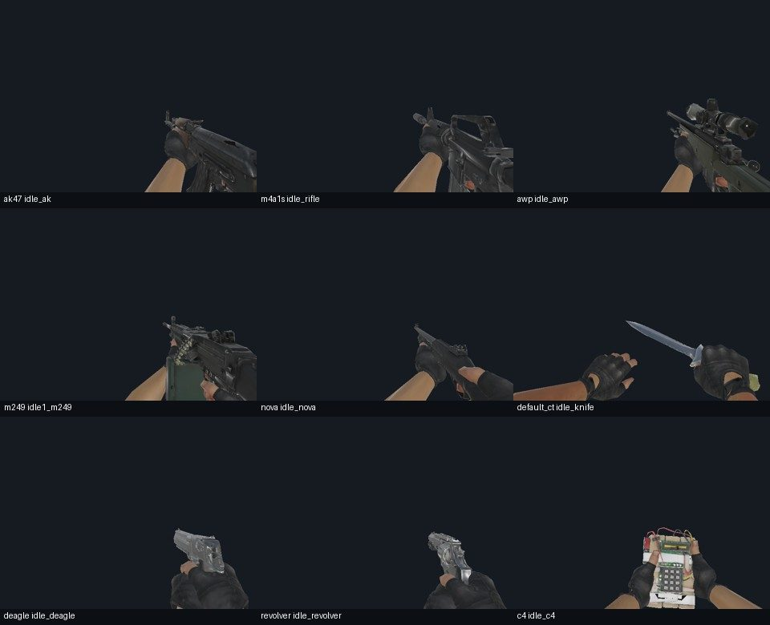
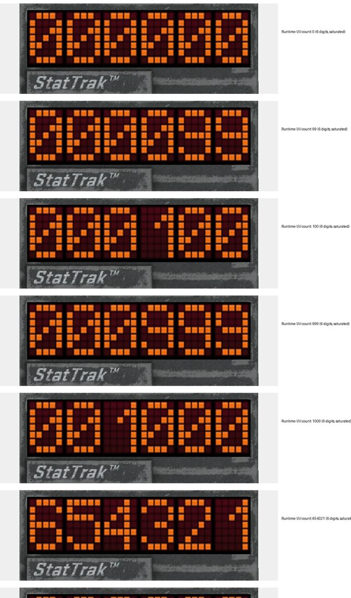
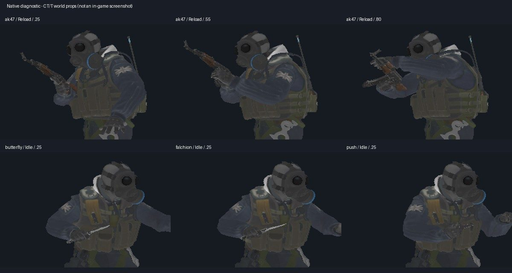
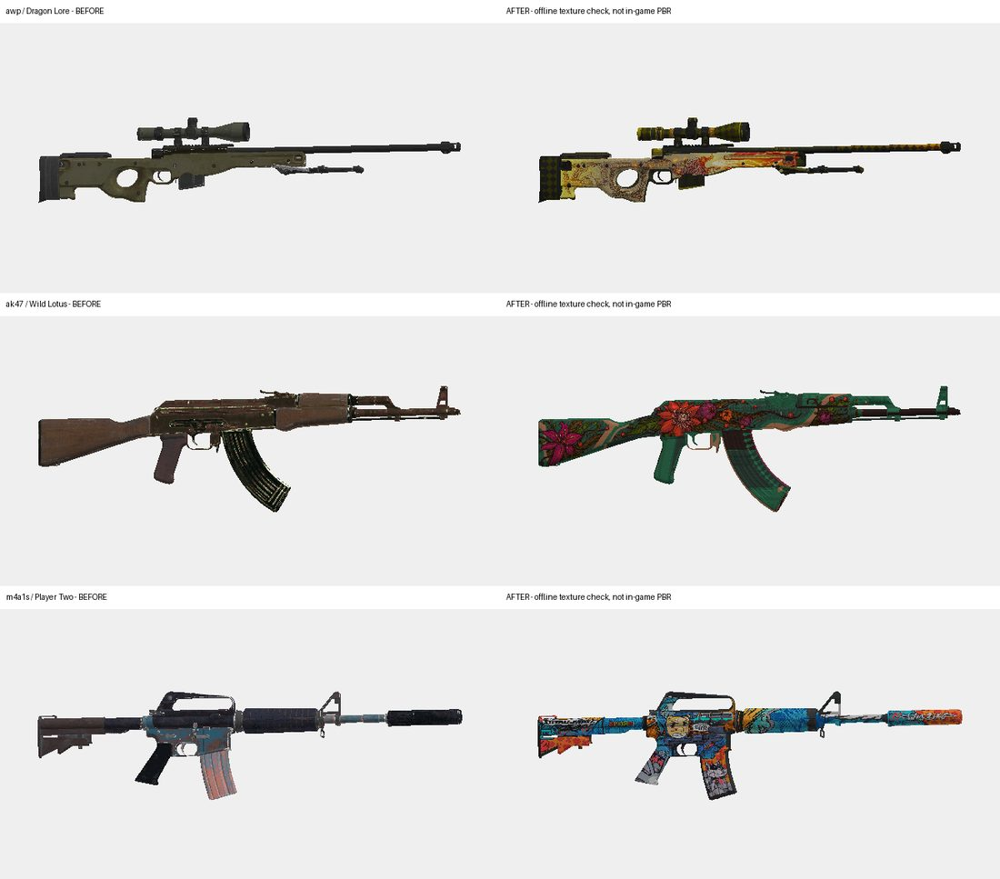

# ScCsgoKnives — CS武器

给《生存战争》（Survivalcraft，SCAPI 1.9.x 模组接口）做的 CS2 武器模组，游戏里的名字是“CS武器”。它把 22 把刀、35 把枪、6 种投掷物带进游戏，模型、骨骼动画和第一人称手臂／手套都用 CS2 的；在此之上加了一整套生存玩法：自己造枪、枪会磨损、能靠击杀成长，后期有自然刷新的敌对小队、要拆的 C4 和定期空投，另有一个联机用的死亡竞赛附属包。

当前版本 **1.5.3**（2026-11-08）。



*各类武器的第一人称待机姿态。这张图和下面几张都是开发时的离线渲染预览，不是游戏内截图。*

## 有哪些包

| 包 | 大小 | 内容 | 怎么装 |
| --- | ---: | --- | --- |
| 全量包 | 约 531 MB | 全部武器和完整资源，已包含探员内容 | 单独使用 |
| 轻量包 | 约 36 MB | 同样的武器和玩法，资源体积小得多 | 手机建议用它，再加探员包 |
| 探员包 | 约 43 MB | CT／T 同伴、敌对小队、空投、防爆盾、拆弹、手套、CS 小鸡、探员语音 | 配轻量包；全量包不用再装 |
| 死亡竞赛 | 约 0.4 MB | 联机个人死亡竞赛 | 可选，需要同版本的全量包或轻量包 |

文件名格式：`[API1.9]CS武器<版本>-全量包.scmod`、`-轻量包.scmod`、`-探员包.scmod`、`-死亡竞赛.scmod`。

| 想要的功能 | 需要安装 |
| --- | --- |
| 只要 CS 武器 | 全量包，或轻量包 |
| 武器、同伴、敌对小队、拆弹和空投 | 全量包，或轻量包 + 探员包 |
| 联机死亡竞赛 | 上面任意一种 + 死亡竞赛包 |
| 玩家自己变成 T／CT 外观 | 另装 NekoMeko Model 1.1 和 Neorxna 1.4；没装不影响同伴和第一人称手套 |

安装注意：

- 全量包和轻量包是两个“核心包”，**只启用其中一个**。
- 联机时所有人要用同一批配套包；全量包可以和“轻量包 + 探员包”一起联机。
- 支持的游戏接口版本：单机 SurvivalcraftAPI 1.9.3.1、1.9.4、1.9.5、1.9.5.1；联机 1.9.3.2_MP 和 1.9.5.1_MP。
- **升级前请自己备份世界。** 模组不会自动备份玩家的世界。从 1.4.0 起，各正式版之间的存档可以直接来回切换（每次发布前都拿之前每个正式版实测）。
- 安装包由本仓库的打包流水线生成到 `output/`，该目录不进 Git，所以仓库里没有安装包。

## 机制与数值设计

下面每一块都写了规则、关键数字和这样定的原因。数字以 1.5.3 的源码为准（标了对应的源文件），原因出自 `docs/` 下的设计文档和发布记录；没有记录的地方只写规则，不补理由。

几个词先说明一下：

- **攻击力**：生存战争里一次攻击的强度。实际掉多少血还要再除以目标的抗性，所以同样的攻击力打不同生物掉血不同。
- **原厂外观／皮肤**：原厂外观是武器默认的样子；皮肤是 CS2 的涂装，在武器装配台更换。
- **游戏日**：游戏里的一昼夜。下面的天数都按世界累计经过的游戏时间算，只改昼夜显示不算数。

### 1. 枪的基础伤害、距离衰减、爆头和护甲

**基础伤害**（`World/ScSurvivalBalance.cs`）。每把枪有一个打生存模式生物用的基础攻击力，再统一乘 1.5：

| 枪类 | 基础表 | ×1.5 后的近距离攻击力 |
| --- | ---: | ---: |
| 普通手枪 | 7 | 10.5 |
| 沙鹰 / R8 左轮 | 14 / 18 | 21 / 27 |
| 冲锋枪 | 6 | 9 |
| 加利尔、法玛斯 | 9 | 13.5 |
| AK-47、M4、AUG、SG553 | 10 | 15 |
| 机枪 | 8 | 12 |
| 连狙 / SSG 08 / AWP | 16 / 26 / 38 | 24 / 39 / 57 |
| 霰弹枪（整发，全部弹丸命中） | 16～24 | 24～36 |
| 电击枪 | 100 | 150 |

统一乘 1.5 是 2026-09-07 按社区反馈定的，“只乘一次”，之后的距离衰减、弹丸分摊、爆头都在这个结果上算。霰弹枪的整发伤害平分给每颗弹丸（Nova 9 颗），不会按弹丸数再乘一遍；它们在低等级另有一段补偿伤害，到 20 级减为零。

**距离衰减**：

| 枪类 | 满伤距离 | 衰减到最低的距离 | 最低比例 |
| --- | ---: | ---: | ---: |
| 手枪、冲锋枪 | 10 格内 | 30 格 | 60% |
| 步枪、机枪 | 20 格内 | 64 格 | 75% |
| 狙击枪 | 40 格内 | 64 格 | 90% |
| 霰弹枪 | 5 格内 | 15 格降到 40%，25 格降到 15% | 15% |

**爆头**（`World/ScHeadshot.cs`）：打中头部伤害 ×2，电击枪不算爆头。部位是按目标当前姿态逐颗子弹判的，头被墙或身体挡住不算。命中标记：白色是命中，黄色是爆头，红色是击杀。

**护甲**（`World/ScArmor.cs`、`World/ScArmorWorkbench.cs`）。护甲不是物品，而是在武器装配台“防护装备”里制作、查看和维修的一组数值，不占衣物栏，也不改角色外观。这是用户明确要求的做法：不新增护甲物品和穿戴模型。

| | 躯干防护（半甲） | 头部防护（半甲之上加成全甲） |
| --- | ---: | ---: |
| 挡 CS 子弹 | 吸收 50% | 吸收 60% |
| 挡普通近战 | 25% | 不参与（近战没有可信的命中部位） |
| 挡其他投射物 | 40% | 50% |
| 新件的吸收预算 | 150 | 100 |
| 覆盖部位 | 躯干和手臂 | 头 |
| 制作材料（人物 3 级） | 铁锭 8、铜锭 4、帆布 6、皮革 4 | 铁锭 6、铜锭 2、帆布 2、皮革 2 |

- 腿没有防护；不能只做头部防护。
- “吸收预算”的单位是攻击力，不是血量：每次吸收多少就扣多少，扣完这件防护就失效。
- 维修按“制作材料的 40% × 已用掉的比例”收费，每种材料向上取整。
- 只有真正造成伤害的攻击才磨损护甲，被盾挡住、被取消或无敌时不扣。
- 这些数值在代码里标注为“第一轮试验值”，并不是照搬 CS2 的护甲规则。

**刀**（`World/ScKnifeStrike.cs`）：原厂外观轻击 7、重击 12；带皮肤的刀轻击 21、重击 36。轻击够得着 2.2 格、间隔 0.45 秒；重击 1.8 格、间隔 1 秒。

### 2. 击杀计数器与枪械成长



在武器装配台给一把枪原地装上“击杀计数器”（CS2 里叫 StatTrak），它就从这一刻开始数这把枪的有效击杀。**击杀数直接决定等级，没有单独的经验值。** 所有规则在 `World/ScGunGrowth.cs`。

**装计数器**：需要 3 级；精密机构 4、光学组件 1、锗块 8、钻石 2。装之前的击杀不补算。

**升级需要的击杀数**（满级 50）：

| 等级段 | 每级需要 | 到段末累计 |
| --- | ---: | ---: |
| 1～10 | 25 | 250 |
| 11～20 | 50 | 750 |
| 21～30 | 100 | 1750 |
| 31～40 | 150 | 3250 |
| 41～50 | 200 | 5250 |

不同枪的需求再乘一个倍率：

| 枪 | 倍率 | 满级累计击杀 |
| --- | ---: | ---: |
| 普通枪 | ×1 | 5250 |
| 狙击枪（AWP、SSG 08、SCAR-20、G3SG1） | ×0.6 | 3150 |
| 电击枪 | ×0.3 | 1575 |
| 机枪（M249、内格夫） | ×1.5 | 7875 |

**各属性怎么涨**。所有加成都从这把枪的**基础值**一次算出，不在已经涨过的数值上再乘，所以反复套用同一等级不会越滚越大。

| 属性 | 每级增量（按 10 级一段） | Lv10 | Lv20 | Lv30 | Lv40 | Lv50 |
| --- | --- | ---: | ---: | ---: | ---: | ---: |
| 伤害倍率 | +0.10 / 0.15 / 0.20 / 0.20 / 0.25 | ×2 | ×3.5 | ×5.5 | ×7.5 | ×10 |
| 弹匣 | +1/20、1/20、2/20、3/20、4/20 | ×1.5 | ×2 | ×3 | ×4.5 | ×6.5 |
| 最大耐久 | +5%、2%、2%、3%、3% | ×1.5 | ×1.7 | ×1.9 | ×2.2 | ×2.5 |
| 电击枪充能时间 | 逐段缩短 | 5 秒 | 3 秒 | 2 秒 | 1.5 秒 | 1 秒 |

以 AK-47 为例：单发攻击力 15 → 150，弹匣 30 → 195 发，耐久 1500 → 3750 发。AWP 弹匣 5 → 32 发。电击枪始终只有 1 发，Lv0 充能 10 秒。

其他属性：

- **散布和镜头后坐力**：乘 (1 − 0.1 × 等级)，到 10 级正好为零。
- **射程**：1～9 级每级 +25%；10 级起取消枪自身的射程上限，子弹只受墙和已加载地形的限制。不会强行加载远处地形，也不带自动瞄准。电击枪保留近距离特例。
- **射速**：0 级就是 CS2 原本的射速。普通枪每级 +0.65%，满级 ×1.325；连狙每级 +0.4%，满级 ×1.2；栓动狙击枪从 11 级才开始涨，满级 ×2.625。
- **皮肤**：装了合适皮肤的枪，伤害再 ×1.5。

**升级那一刻枪的状态**（`World/ScGunGrowthService.cs`）：耐久按比例换算（坏的还是坏的，满的还是满的），已装的子弹数不变，充能剩余时间按比例缩短。升级不送子弹、不修枪、不让充能立刻完成；正在换弹等动作中途不升级，等动作结束再升。

**什么击杀算数**（`World/ScGunKillQueue.cs`）：

| 情况 | 算不算 | 说明 |
| --- | --- | --- |
| 打死自己 | 不算 | |
| 打死其他玩家 | 不算 | 首版有意不让玩家对战来刷成长 |
| 目标不是生物 | 不算 | |
| 有人正骑着的坐骑 | 不算 | 游戏没有驯服系统，“驯养的”就按“正被骑乘”处理 |
| 霰弹一枪多颗弹丸打中同一只 | 算一次 | 同一次扣扳机的弹丸先合并再结算 |
| 创造模式的击杀 | 算 | 和生存模式一样计数 |
| 开枪后、目标死亡前换了枪或把枪丢了 | 记在开枪的那把上 | 归属在开火那一刻就定下 |
| 创造模式复制出来的枪 | 计数器保留，击杀和等级清零 | 否则复制一把满级枪就有了两把 |

每个世界在第一次装计数器前选定“计数并成长”或“只计数”，之后不能改，因为一改就要么收回等级、要么倒补等级。

**规则是怎么演变的**（只写有记录的事实）：

| 时间 | 满级 | 每级击杀 | 满级累计 | 记录 |
| --- | ---: | ---: | ---: | --- |
| 0.40.0（2026-09） | 10 | 100 | 1000 | `docs/gun-counter-growth-0400.md` |
| 2026-09-10，0.41.10 | 30 | 100 | 3000 | `docs/growth30-ghoul-test-0418.md`：耐久保持温和增长，把后 20 级的收益集中在伤害、射速和弹匣 |
| 1.0.14 预览版起，沿用至今 | 50 | 分段 25～200 | 5250 | `docs/migration-100-risk-20260915.md`；代码注释：50 级只是把 30 级版本的总收益摊到 50 级，满级仍是伤害 ×10、弹匣 ×6.5、耐久 ×2.5，10 级的数值不变 |

- 2026-09-12 的设计方向写的是“枪难做、成长难练，但练成后仍然够强”（`docs/gun-registry-shared-storage-plan-2026-09-12.md`）。
- 2026-09-24 的平衡分析指出，后期容易碾压普通怪的主要原因是 10 级就零散布、零后坐力、无距离衰减，再加上满级伤害 ×10、皮肤 ×1.5、弹匣 ×6.5；光降射速解决不了（`docs/gun-balance-plan-2026-09-24.md`）。现行规则保留 0 级的 CS2 原射速，只压低了等级带来的射速加成。

### 3. 耐久与维修

耐久是一个精确的“还能打多少发”，每真正开一枪扣 1（`World/ScGunDurability.cs`）。新枪的寿命按枪类定：

| 手枪 | 冲锋枪 | 步枪 | 霰弹枪 | 栓动狙击 | 连狙 | 机枪 | 电击枪 |
| ---: | ---: | ---: | ---: | ---: | ---: | ---: | ---: |
| 1200 | 2000 | 1500 | 300 | 200 | 500 | 4000 | 100 |

- 耐久**只是维护成本**：不影响伤害、射速和精度，也没有随机卡壳，射击表现始终可预测。打到 0 就不能开火，要回装配台维修。
- 剩余不超过 20% 时显示橙色提醒。
- 维修按缺损比例收材料，只在最后向上取整一次；价格随等级涨，每满 10 级加 20%，50 级的枪维修价是 0 级的 2 倍（`World/ScWeaponRepair.cs`）。

每把枪的状态（耐久、子弹、等级、充能）是按枪单独存在世界里的，所以放进箱子、丢在地上、换到别的格子都不会和另一把同型号的枪串在一起。

### 4. 投掷物

6 种：高爆手雷、闪光弹、烟雾弹、燃烧瓶、燃烧弹、诱饵弹。

**重投和轻投**（`World/ScGrenadeBallistics.cs`）：

| | 出手速度 | 说明 |
| --- | ---: | --- |
| 重投（左键点按；手机“强投”） | 20 格/秒 | 早期是 14，玩家反馈投掷力度小，改为 20 |
| 轻投（右键；手机“轻投”） | 10 格/秒 | 早期是 6 |
| 叠加玩家自身速度 | ×1.25 | CS:GO SDK 里的系数，只在出手瞬间取一次 |

按住是拉环举手准备，可以一直瞄准，松开才出手；切走武器可以取消。出手后才扣物品、开始算引信：普通投掷物 1.5 秒，燃烧类 3 秒。

**各投掷物的数值**（`World/ScGrenadeState.cs`、`ScFireArea.cs`、`ScSmokeVolume.cs`）：

| 投掷物 | 数值 |
| --- | --- |
| 高爆手雷 | 中心伤害 120，半径 7.8 格，越往外越小，墙能挡 |
| 燃烧瓶／燃烧弹 | 火区每秒 7.5 伤害，重叠的火区不叠加 |
| 闪光弹 | 作用半径 40 格，最长致盲 5.5 秒，墙能挡，队友扔的也会致盲 |
| 烟雾弹 | 圆柱形烟，直径约 7.5 格，持续 20 秒 |

**烟雾挡视线**是这套投掷物的核心：烟的画面、玩家在烟里看到的遮罩、敌人和同伴的“能不能看见目标”读的是**同一个密度值**，沿视线每 0.25 格取一次样。所以玩家看到的烟的边缘，就是敌人视线被挡住的边缘。高爆手雷能在烟里炸开一个半径 4.5 格的洞，保持 1.5 秒后用 2 秒回填，这个洞对玩家和对敌人同样有效。

爆炸会吓跑附近的动物、惊飞鸟：高爆 50 格、闪光 40 格、C4 和敌方炸弹 70 格。这是 2026-10-21 采纳的玩家建议。

### 5. 敌对小队（需要全量包或探员包）



敌人是自然刷新的 T 小队。最初的方案是“主动追击的挑战”，2026-09-20 用户改成“像原版敌对生物一样自然刷新”，和玩家是否招募了同伴无关。

**刷新规则**（`World/ScExtraSettings.cs`、`ScCsgoTactical/SubsystemTacticalEnemies.cs`）：

| 规则 | 数值 |
| --- | --- |
| 哪些世界会刷 | 生存类模式，且生物环境为“活跃”；创造、无害和静态环境不刷 |
| 开档保护期 | 默认满 30 个游戏日后才开始刷，可在设置里调成 0～365 天 |
| 编成 | 世界第 30 天之前：3 人（狙击手、步枪手、近距离突击手）；第 30 天起：5 人（再加机枪手、带 C4 的爆破手） |
| 落点 | 离玩家 32～44 格的露天可站地面，优先选玩家看不到的位置，离任何玩家不少于 28 格 |
| 出现时 | 有 3 秒准备时间，期间不开火 |
| 整队生成 | 全队每个落点都检查通过才一起出现，否则整队延后 |

刷新密度三档，在设置里选：

| 密度 | 自然刷新的敌人总数上限 | 两队最短间隔 | 队与队最小距离 |
| --- | ---: | ---: | ---: |
| 稀少 | 5 | 120 秒 | 128 格 |
| 标准（默认） | 10 | 60 秒 | 96 格 |
| 较多 | 15 | 40 秒 | 72 格 |

- 人数上限只拦新队伍，不会为了凑数删掉已有的敌人。最低的“稀少”档也容得下一支 5 人队。
- 小队刷新遵守游戏原版的生物总数上限，和其他生物抢名额，**不是到时间必刷**。这是用户在 2026-09-29 选定的：不给 CS 敌人单独开刷新额度。
- “近距离突击手”拿的是冲锋枪或霰弹枪，不是刀。敌人用 34 把普通枪（电击枪不进池），没有皮肤、计数器和等级。

**战斗行为**（`ScCsgoTactical/ComponentTacticalEnemy.cs`）：

| 项目 | 数值 |
| --- | --- |
| 主动发现玩家 | 生存模式下会巡逻，32 格内看得见就进攻；被打则不限距离还击 |
| 听声 | 普通枪声 40 格、带消音器 12 格、电击枪 6 格；来源不明的声音先过去查看 |
| 开火前瞄准 | 狙击手至少 1.4 秒，其他人 0.55 秒 |
| 射击节奏 | 步枪 3 发一组、机枪 8 发一组、狙击每次 1 发；组间停 0.75 秒（狙击 0.6 秒） |
| 开火距离 | 狙击 64 格、其他 40 格；近距离突击手 18 格内才主动开火 |
| 瞄准误差 | 瞄的是身体中心附近：狙击 ±0.15 格、其他 ±0.45 格，自己移动时更不准；不专门瞄头 |
| 弹药 | 出生一匣加三匣备用，打光就撤，不会凭空补满；换弹 2.8 秒，机枪 4 秒 |
| 投掷物 | 每人出生随机带 0～2 枚；同一队至少隔 8 秒才扔下一枚 |
| 撤退 | 血量低于 33% 撤退，回到 40% 再打回来 |
| 视线 | 墙、身体、烟雾都会挡；被闪光致盲时停火 |

**敌人打玩家的伤害单独一张表**（`ScCsgoTactical/TacticalHostileBalance.cs`）。原因：敌人最初直接用“玩家打怪”的那套攻击力，而玩家的抗性比怪物低得多，算下来一发步枪子弹就是一个满血新角色血量的 120%～150%，裸装玩家即使有 3 秒预警也会突然死亡。所以敌人打玩家改用一套小得多的数值（近距离每发）：

| 敌人的枪 | 攻击力 | | 敌人的枪 | 攻击力 |
| --- | ---: | --- | --- | ---: |
| 普通手枪 | 1.8 | | 连狙 | 3.0 |
| 沙鹰、R8 | 3.0 | | SSG 08 | 4.0 |
| 冲锋枪 | 1.4 | | AWP | 5.5 |
| 步枪 | 2.2 | | 泵动霰弹（整发） | 4.2 |
| 机枪 | 1.8 | | XM1014（整发） | 3.2 |

- 打中玩家头部 ×1.25，没有用 ×2，为的是不让新手被一枪爆头带走。
- 这张表只管“敌人打玩家”。敌人打同伴和其他生物、玩家和同伴打敌人，都仍用原来的数值。
- 是不是敌人看的是身份，不是外观：招募来的 T 同伴是友军，不会因为长得像 T 就被削弱或变成敌人。

**敌人掉落**：弹药 60%（1～2 份）、枪械零件 40%（1～2 件）、铁锭／铜锭／煤 50%（1～2 个）、CS 小鸡蛋 8%，各自独立抽。1.5.0 起敌人不再掉枪。

### 6. 敌方 C4 与拆弹

5 人队里的爆破手会在 80 格范围内找玩家，走到离玩家 12 格以内安放 C4（`ScCsgoTactical/SubsystemTacticalBombs.cs`）。

| 项目 | 数值 |
| --- | --- |
| 安放 | 停步蹲下 3.2 秒；被打、移动、被闪都会打断；每人一生只有一枚 |
| 起爆 | 装好后固定 **40 秒** |
| 威力 | 中心伤害 250，半径 12 格，越往外越小，墙能挡，不破坏地形 |
| 拆除 | 对准炸弹，2.5 格内按住 E；**徒手 10 秒，带着拆弹钳 5 秒** |
| 拆弹钳 | 在装配台制作，放在背包或快捷栏里就生效，不消耗 |
| 拆除奖励 | 金属坯件 2、精密机构 1 |

- 40 秒、10 秒、5 秒这三个数是用户在 2026-09-20 定的。这 40 秒只属于敌方炸弹，玩家自己的 C4 仍然可以设 5～300 秒。
- 界面显示剩余爆炸时间、还要拆多久和进度条。时间不够时显示红色“时间不足”，余量不到 1 秒显示黄色“时间紧迫”；来不及也允许尝试，由玩家自己判断。
- 松手、移开准星、走远、隔墙、开背包、死亡都会中断，重拆从零开始。同一枚炸弹一次只能一个人拆。
- 拆完的时刻必须早于起爆时刻；恰好同时按爆炸算。
- 爆破手死了，已经装好的炸弹不会消失。
- 滴声按这枚炸弹的实际剩余时间排，最后 1.5 秒才进入警报声。

### 7. 空投（需要全量包或探员包）

| 项目 | 数值 |
| --- | --- |
| 间隔 | 默认每 15 个游戏日一次，可调 1～365 天，可以关闭 |
| 落点 | 离玩家 32～56 格 |
| 守卫 | 每个空投 5 名敌人 |
| 标记 | 红色烟柱，远处就能看到 |
| 内容 | 7 类各一份：枪 1 把、配套弹药 2～3 份、投掷物 1～2 个、CS 刀 1 把、铜或铁护甲 1 件、熟食 3～5 个、资源 2～3 组 |

这组数字来自 2026-10-12 的玩家原话：“空投过于频繁建议15天游戏时间一次，种类增加食物，护甲，近战兵器，投掷类，弹药类，枪械类，资源类……最好是希望可以增加空投在设置里面调节成那种可以开关的设置 自己调节空投的天数”。每箱的内容由这次空投的编号决定，落地受阻后重试不会重新抽奖。联机时由房主设置。

### 8. 同伴与队友免伤

可以招募 CT、T 同伴和人质。同伴用的是真实的 CS 枪，带皮肤、计数器、等级和耐久。

**1.5.0 起，玩家的任何攻击都伤不到招募来的同伴**：CS 枪、刀、电击枪、手雷、火、C4，以及原版和其他模组的武器都一样。敌人照样能伤同伴；玩家之间能不能互相伤害，仍由世界选项“友军伤害”决定。

起因是 2026-10-21 的玩家建议：“希望增加队友免伤，老是误伤队友，心累~”。改之前，同伴只在世界关闭“友军伤害”时才躲得开玩家的范围伤害，子弹和刀则总会伤到。

### 9. 死亡竞赛（需要死亡竞赛包）

在房主专门圈出的竞技区域里打个人死亡竞赛，只在房主启用的世界生效，不改变普通生存世界。入口：模组设置 → CS武器 → 死亡竞赛设置。

| 项目 | 数值 | 来源 |
| --- | --- | --- |
| 每条命 | 100 血、100 护甲带头盔，每次复活恢复 | 用户指定 |
| 复活保护 | 3 秒，自己开火、挥刀或投掷会提前结束 | 用户指定 |
| 弹药 | 备弹无限，但仍要换弹 | 用户指定 |
| 成长与皮肤 | 没有磨损、没有等级增伤、皮肤不加伤害 | 用户指定 |
| 一局时长 | 默认 10 分钟，房主可调 1～60 | 默认值 |
| 死亡镜头 | 2 秒 | 默认值 |
| 开局倒计时 | 5 秒 | 默认值 |
| 出界 | 离开区域 3 秒算一次死亡 | 默认值 |
| 助攻 | 对方那条命结束前 10 秒内造成至少 20 点伤害 | 默认值 |
| 投掷物 | 默认关闭；开启后每条命最多 3 个 | 默认值 |

死亡竞赛世界里另有几条只在这里生效的 CS2 规则，是用户在第 5、6 轮试玩后要求补上的：

- **持枪移速**：拿刀等于游戏原本的行走速度，其他武器按 CS2 的移速比例折算。
- **命中判定**：改用 CS2 的命中体，分头、颈、胸、腹、手臂、腿，各部位之间的空隙算打空。
- **扫射弹道**：按 CS2 的固定图案。
- **穿透**：按方块材质和厚度判断能不能打穿，木制方块一律容易穿，能打穿人。

比赛期间不会饿、不会冷、受伤不红屏；默认开启“比赛环境”：静态环境、没有天气、永远正午，只在比赛期间生效，不会改动世界自己的设置。这几条来自 2026-10-21 的玩家建议。

## 外观



武器皮肤在武器装配台更换。玩家自己的 T／CT 外观通过 NekoMeko 的角色选择切换，只改外观，不改阵营、血量和装备属性。

## 怎么测试

- **打包后再检查**：检查工具直接加载**打好的安装包里的 DLL** 来跑，而不是只测源码编译的结果，这样打包环节出的问题也能查到。1.5.3 的发布关卡：死亡竞赛检查 254/254；包元数据 7/7；存档在 1.4.0、1.5.0、1.5.1、1.5.2 和 1.5.3 之间来回切换，每组 249～251 项全部通过。
- **实机**：单机 1.9.3.1 加最终全量包 21/21；联机 1.9.5.1_MP 下，房主用“轻量包 + 探员包”，客户端用全量包，都加死亡竞赛包，17/17。
- **拿上一版做对照**：同一套联机检查拿已发布的 1.5.2 去跑是 15/17，没过的正是 1.5.3 要修的那两项。这说明检查确实能抓出旧版的问题，而不是怎么跑都通过。队友免伤、爆炸吓跑动物的检查也一样：新版通过，上一个正式版在这些项上失败。
- **没覆盖到的**（如实记录在 `docs/tasks/release-1.5.3-20261108.md`）：1.5.3 没有在安卓手机上测；三人及以上的联机实机没跑；按用户决定，这一版只是适配新的联机接口加改版本号，所以只跑了缩减后的关卡，其余沿用同一处源码改动的候选版证据。

每个版本的发布记录、测试结果和未完成的验收都在 `docs/` 和 `docs/tasks/` 下。

## 构建

完整的资源、游戏接口和打包流水线在 Windows 上运行，命令统一经过 `tools/dev.ps1`：

```powershell
./tools/dev.ps1 dotnet build src/ScCsgoKnives/ScCsgoKnives.csproj -c Release -p:SkipScmodPackaging=true
```

这只编译主程序，不会产出四个安装包。正式打包要用已发布的上一版安装包作基线，并在各个受支持的游戏接口版本上过关卡，细节见 [docs/agent-guide/build-and-release.md](docs/agent-guide/build-and-release.md)。参与开发前请先读 [AGENTS.md](AGENTS.md)。

## 素材来源与版权

本模组是玩家自制的非官方作品，免费发布，不设付费内容。

- 当前的武器模型、材质、骨骼动画和真实手臂／手套网格，转换自用户本机已有的 Counter-Strike 2 导出资源。**Counter-Strike 2 及其素材归 Valve 所有。**
- 击杀提示音取自用户本机安装的 Battlefield 1（EA / DICE）。**游戏音频仍归各自的权利人所有，不在本项目代码许可的覆盖范围内。**
- 项目还包含改编自以下来源的素材：CSMC 客户端的武器资源（其中的武器模型和动画已在 0.20.4 移除，保留下来的图标、音效和光照资源仍适用原署名）；`White_Food` 的 `[TaCZ X LR] CS2 Knifes Packet v1.0.1`（CurseForge 文件 `6635636`）中的栏位图标和音效。仓库维护者声明已取得许可，可以改编并随本移植公开再分发。**再分发本项目时请保留原作者和来源署名。**
- 架构参考：[MCModderAnchor/TACZ](https://github.com/MCModderAnchor/TACZ) 和 [LesRaisins-Studios/LesRaisins-Tactical-Equipements](https://github.com/LesRaisins-Studios/LesRaisins-Tactical-Equipements)，两者代码均为 GPL-3.0。

逐项来源和转换记录见 [ASSET_SOURCES.md](ASSET_SOURCES.md)，第三方署名的完整原文见 [THIRD_PARTY_NOTICES.md](THIRD_PARTY_NOTICES.md)，以这两个文件为准。

## 许可

代码采用 GPL-3.0，见 [LICENSE](LICENSE)。上面列出的游戏素材不属于代码许可的范围。

## 更早的版本记录

这份说明以前按版本逐条记录了 0.26 到 0.36 的改动。这些内容仍在 Git 历史里，各版本的详细记录在 `docs/` 下（例如 `docs/community-m4-0350.md`、`docs/m4-0360-report.md`）；1.5.0 相对 1.4.0 的改动见 [docs/changelog-1.5.0.md](docs/changelog-1.5.0.md)。
